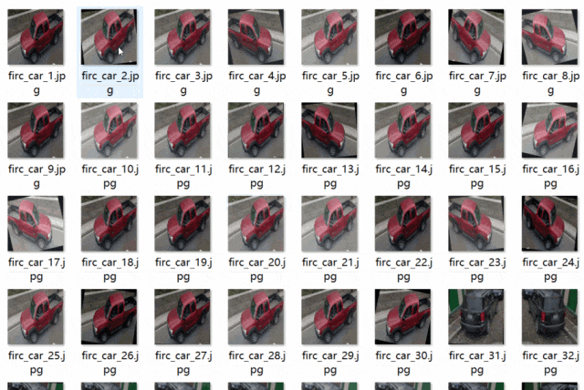
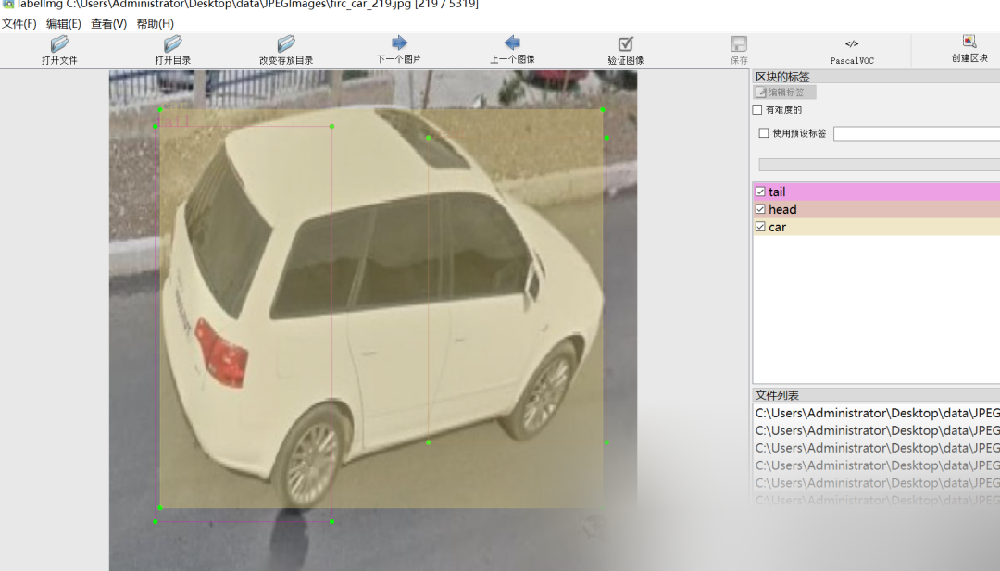

# [Dataset] [Object Detection] Car Head and Tail Detection Dataset VOC+YOLO format with 5319 images in 3 categories

Dataset Producer: Future Autonomous Research Center (FIRC)
Copyright Holder: Future Autonomous Research Center (FIRC)
Copyright Notice: The dataset is solely for personal use and must not be publicly sold on unauthorized trading websites such as Taobao or Xianyu without authorization. Legal responsibilities arising from this usage must be borne by the user.
Dataset Format: Pascal VOC format + YOLO format (containing only txt files without split paths, consisting of jpg images along with corresponding VOC format xml files and yolo format txt files).
Number of Images (Total jpg Files): 5319
Number of Annotations (Total xml Files): 5319
Number of Annotations (Total txt Files): 5319
Number of Annotation Categories: 3
Annotation Category Names: ["car", "head", "tail"]
Number of Boxes per Category:
car boxes = 6355
head boxes = 4640
tail boxes = 3291
Total Boxes: 14286
Labeling Tool Used: labelImg
Labeling Rules: Draw rectangle boxes around categories.
Important Note: No guarantees are made regarding the accuracy or precision of the trained models or weight files. The dataset provides accurate and reasonable annotations only.

Image Preview:

Annotation example:

## Payment

Here is a pay link on Stripe ( https://buy.stripe.com/3cs8yP7sY87d0vu9AB ). Please contact me lonlonago@foxmail.com after funding $89, and I will send you a complete data files , thank you!

